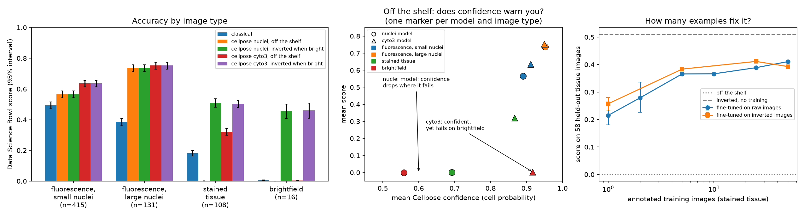

# nuclei-shift

How well do off-the-shelf nucleus segmentation models cope when microscope images look different from what
they were trained on, does their own confidence warn you when they fail, and how much does fixing it cost?

**Short answer:** Cellpose's nucleus model scores zero on stained tissue and brightfield images, because there
the nuclei are dark on a bright background. One line of preprocessing (inverting brightness on bright images)
recovers most of it. The specialist nucleus model's confidence flags its own failures almost perfectly; the
generalist model stays confident while failing completely on brightfield images.

## Data

[BBBC038v1](https://bbbc.broadinstitute.org/BBBC038) (Caicedo et al., *Nature Methods* 2019), the 2018 Data
Science Bowl nucleus dataset, released under CC0. The 670 training images have a mask for every nucleus.

Each image is assigned to one of four groups from its appearance and nucleus size (`prepare.py`):

| Group | Rule | Images |
|---|---|---|
| Fluorescence, small nuclei | grey, dark background, median nucleus under 700 px (a clear gap in the size distribution) | 415 |
| Fluorescence, large nuclei | grey, dark background, median nucleus 700 px or more | 131 |
| Stained tissue | colour image (the dataset paper's purple and pink tissue groups, merged) | 108 |
| Brightfield | grey with a bright background | 16 |

## Methods

- **Classical baseline:** Otsu threshold and distance-transform watershed (scikit-image), inverting
  bright-background images.
- **Cellpose 3**, two pretrained models used off the shelf: `nuclei` (a specialist) and `cyto3` (a generalist),
  with nucleus size estimated automatically.
- **Two conditions** for each Cellpose model: *off the shelf* (one setting for every image) and *inverted when
  bright* (brightness inverted when an image's grey median is above 0.4, the same rule the classical method uses).
- **Score:** the Data Science Bowl metric per image, the mean over IoU thresholds 0.5 to 0.95 of
  TP / (TP + FP + FN), averaged over images with 95% bootstrap intervals (`evaluate.py`).
- **Confidence:** each image's mean Cellpose cell probability inside its predicted nuclei; an image with no
  predicted nuclei counts as zero confidence.

## Results

| Method | Fluorescence, small (415) | Fluorescence, large (131) | Stained tissue (108) | Brightfield (16) |
|---|---|---|---|---|
| Classical | 0.492 [0.470, 0.515] | 0.385 [0.360, 0.408] | 0.183 [0.164, 0.200] | 0.006 [0.004, 0.008] |
| Cellpose nuclei, off the shelf | 0.565 [0.543, 0.587] | 0.736 [0.712, 0.758] | **0.001** [0.000, 0.002] | **0.000** [0.000, 0.000] |
| Cellpose nuclei, inverted when bright | 0.565 [0.543, 0.587] | 0.736 [0.712, 0.758] | **0.509** [0.482, 0.536] | **0.454** [0.406, 0.501] |
| Cellpose cyto3, off the shelf | 0.636 [0.615, 0.656] | 0.753 [0.729, 0.775] | 0.321 [0.299, 0.344] | 0.004 [0.001, 0.006] |
| Cellpose cyto3, inverted when bright | 0.636 [0.615, 0.656] | 0.753 [0.729, 0.775] | 0.504 [0.479, 0.527] | 0.461 [0.409, 0.507] |

Does Cellpose's confidence warn you? An image counts as failed below a score of 0.1.

| Model, condition | Failed images | Confidence flags failures (AUROC) | Confidence vs score, within image groups (Spearman) |
|---|---|---|---|
| nuclei, off the shelf | 145 | **0.996** | 0.41 |
| nuclei, inverted when bright | 25 | 0.972 | 0.56 |
| cyto3, off the shelf | 29 | **0.712** | 0.26 |
| cyto3, inverted when bright | 9 | 0.925 | 0.43 |

Mean confidence on brightfield images, off the shelf: nuclei model 0.56 (it finds 2 of 84 nuclei per image);
cyto3 0.92 (it finds 55 objects per image, almost all wrong, score 0.004).

<!-- FINETUNE -->



## What I found

1. **The specialist fails completely on a predictable shift.** The nucleus model, trained mostly on bright
   nuclei against a dark background, outlines the background in stained tissue and brightfield images and
   scores zero. I checked pixel overlap with the ground truth to rule out a bug in my scoring: it really is
   segmenting the wrong regions.
2. **One line of preprocessing recovers most of it.** Inverting brightness on bright images lifts stained tissue
   from 0.00 to 0.51 and brightfield from 0.00 to 0.45, without touching the fluorescence results.
3. **The generalist survives partly, but gains nothing once the fix is applied.** cyto3 manages 0.32 on stained
   tissue off the shelf; after inversion both models reach the same level (0.50 to 0.51).
4. **The specialist knows when it fails; the generalist does not.** When the nucleus model is out of its depth its
   confidence drops and it finds few objects, so its confidence flags its failures almost perfectly (AUROC 0.996).
   cyto3 stays as confident on brightfield images, where it scores 0.004, as on fluorescence, so its confidence
   flags failures only moderately (0.71).
5. **Within a group, confidence is a weaker guide.** Once image type is accounted for, confidence and accuracy
   correlate at 0.26 to 0.56. Much of the warning signal is the model recognising an unfamiliar kind of image.

## Deployment

`predict.py` segments a folder of images and writes 16-bit label images plus a `summary.csv` (nuclei found,
median area, confidence, whether the image was inverted, seconds taken). The `Dockerfile` packages it on CPU
with both models' weights downloaded at build time.

The container was built and tested in Google Cloud Build (`cloudbuild.yaml`): it builds the image, runs it on the
three images in `sample/` and prints the summary, without pushing the image anywhere. It succeeded in 3.5 minutes
and gave exactly the same results as a local run (22, 22 and 72 nuclei; the stained tissue image has 70 in the
ground truth).

<!-- COST -->

## Limitations

- One dataset. The four groups come from a fixed rule on appearance and nucleus size, not from the original
  per-image labels, which the dataset does not publish.
- Brightfield has only 16 images, so its intervals are wide.
- Cellpose 3 models only; StarDist needs TensorFlow, and Cellpose 4's large Cellpose-SAM model was out of scope.
- No per-image parameter tuning, deliberately: the question is what an off-the-shelf user gets.
- Confidence is one simple measure, the mean cell probability inside predicted nuclei.

## Reproduce

```bash
python3.12 -m venv .venv && source .venv/bin/activate && pip install -r requirements.txt
mkdir -p data && cd data
curl -LO https://data.broadinstitute.org/bbbc/BBBC038/stage1_train.zip && unzip -q stage1_train.zip -d stage1_train
curl -LO https://data.broadinstitute.org/bbbc/BBBC038/metadata.xlsx && cd ..
python measure.py                 # per-image colour, brightness and nucleus size
python prepare.py                 # image groups and ground-truth label images
python segment.py classical       # also cp_nuclei, cp_cyto3, cp_nuclei_inv, cp_cyto3_inv
python evaluate.py                # tables in results/
python finetune.py                # fine-tuning on stained tissue (about 2.5 hours on a laptop)
python plot.py                    # results/figure.png
```

Cellpose 3 needs Python 3.12: its NumPy requirement has no build for Python 3.13.
